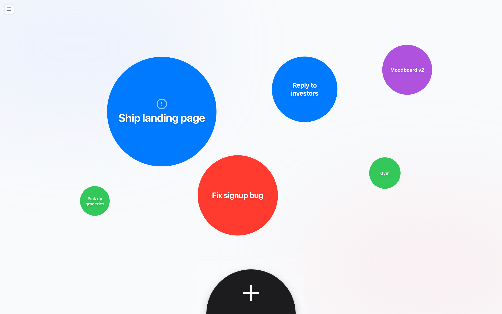
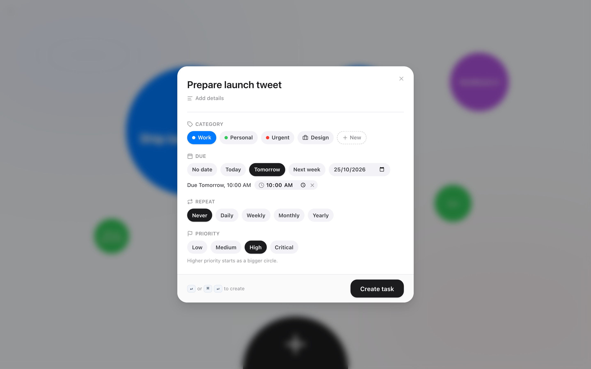

# c-loom

**The to-do list that grows on you.**

Every task is a circle. The longer you leave it, the bigger it gets, 
until it's impossible to ignore.

[**Open c-loom →**](https://c-loom.vercel.app)

 

 

## Why circles?

Most to-do lists treat a task you added five minutes ago the same as one you've been avoiding for a week. c-loom doesn't.

- **Tasks grow while they wait.** A new task starts small and swells a little every hour. The things you keep putting off end up taking over your screen.
- **Important things start big.** Pick a priority and the circle starts larger, so it stands out from day one.
- **Deadlines get loud.** When something is due within 24 hours, it gets a warning sign.
- **Done means gone.** Double-click a circle to finish it and watch your board clear up.

No lists to scroll, no columns to sort. One look tells you what needs you most.

## Adding a task takes a second

Type what needs doing and press Enter. That's it. Everything else is optional:

- **Category**: color-codes the circle. Make your own with a color and an icon, right from the form. The one you used last is already selected.
- **Due date**: one tap for _Today_, _Tomorrow_ or _Next week_, or pick any day. Add a time if it matters.
- **Repeat**: daily, weekly, monthly or yearly. When you finish a repeating task, it comes back for the next date, small again.
- **Priority**: _Low_, _Medium_, _High_ or _Critical_. Higher priority starts as a bigger circle.

## Features

- 🫧 **Circles that grow with time and priority**: your board shows what's been waiting longest.
- ⚠️ **Deadline alerts** for anything due in the next 24 hours.
- 🔁 **Repeating tasks** that move to their next date when you finish them.
- 🌌 **Galaxies** to keep work, home and side projects apart. Every task is a world inside one.
- 🤝 **Shared galaxies**: send a link, work on the same tasks together and see changes live. Everyone keeps their own layout of the circles.
- ✅ **A history of what's done**, with who finished each task and when.
- 🏷️ **Custom categories** with your own colors and icons.
- ☁️ **Sync with Google sign-in**, across all your devices, with your board laid out the same way everywhere.
- ⌨️ **Keyboard first**: create a task without touching the mouse.

## Try it without an account

Open [c-loom.vercel.app](https://c-loom.vercel.app) and start right away. As a guest, your board is saved in your browser.

When you want your tasks on every device, **sign in with Google**. c-loom offers to bring over everything you made as a guest, and merges it into your galaxy without duplicates.

## Keyboard shortcuts

| Action             | Shortcut                      |
| ------------------ | ----------------------------- |
| New task           | <kbd>⌘</kbd> <kbd>Enter</kbd> |
| Create the task    | <kbd>Enter</kbd>              |
| Complete a task    | Double-click the circle       |
| Open the guide     | <kbd>⌘</kbd> <kbd>G</kbd>     |
| Show all shortcuts | <kbd>⌘</kbd> <kbd>K</kbd>     |

On Windows and Linux, create a task with <kbd>Ctrl</kbd> <kbd>Enter</kbd>.

## Questions

**Where is my data?** 
As a guest, only in your browser on this device. Once you sign in, it's stored in your account. Nobody else can see your galaxies unless you share one, and then only the people in that galaxy see it.

**What happens when I finish a task?** 
It leaves the board: c-loom shows what's still on your plate. With an account, it's kept in the galaxy's Completed list, so a shared galaxy knows who did what. Repeating tasks move to their next date instead.

**Will my deadlines be right if I travel?** 
Yes. Due dates are saved in a universal time and always shown in your current time zone.

## Built with

Next.js, React, TypeScript, Tailwind CSS and Supabase.
